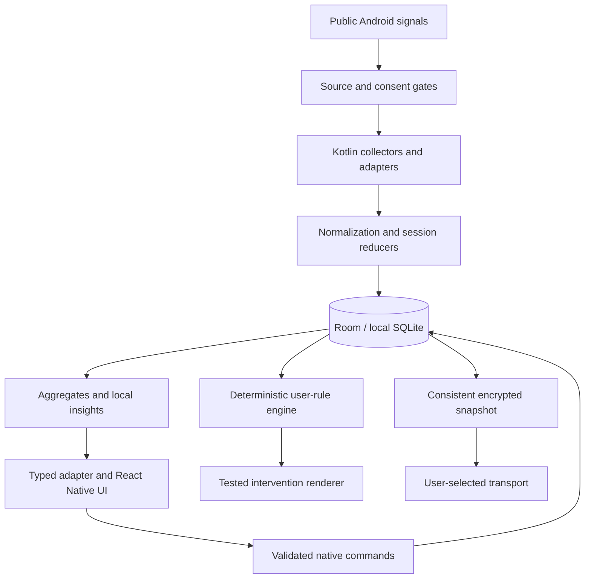

# Architecture

**Status:** Mobile architecture accepted; pure analytics slice and experimental mobile composition/bootstrap source exist; runtime integration unaccepted. Updated 2026-10-27.
**Responsibility:** Owns subsystem boundaries, runtime lifecycle, data flow and future adapters.
**Related specifications:** [Contracts](NATIVE-CONTRACTS.md), [Models](DATA-MODELS.md), [Structure](FILE-STRUCTURE.md), [Dependencies](DEPENDENCIES.md), [Security](SECURITY.md).
**Unresolved feasibility:** F-02–F-04, F-07 and F-08 in [Decisions](DECISIONS.md); service strategy, full toolchain and product encryption integration remain unqualified; isolated store build/phone evidence is scoped below.

## Runtime boundaries

AS-043 integrates the narrow preview into the existing React Native application. Main screens, navigation, consent, privacy and settings are TypeScript under `src/features`; Kotlin owns Android accessibility, serialized counting/storage, Keystore wrapping and the TurboModule. Only the small cross-app accessibility HUD is native Android UI. `native/reels-core` remains a pure domain module with no Android/storage/React imports; `android/app` supplies adapters and the sole encrypted Room composition root. The `preview` build uses debug-matched native dependencies/signing but bundles JS/Hermes and explicitly disables dev support, so it runs without Metro. This does not replace React Native with Kotlin screens or admit an unqualified social adapter.

Supported product targets are mobile: Android first, future iOS through native adapters. React Native renders mobile components; do not introduce React Native Web, a website/PWA/desktop runtime, an embedded copy of the browser study, or browser-extension scaffolding. AS-033 is a completed non-shipping design reference. A potential Chrome extension is deferred beyond mobile completion and would require a separate design/task decision (ADR-024).

| Layer | Responsibility | Forbidden ownership |
|---|---|---|
| React Native Community CLI / TypeScript / New Architecture | Screens, input validation, accessible charts, read-model cache and navigation | Behavioral-history persistence, background collection timers, authoritative enforcement |
| Typed platform adapter | Capability discovery, requests, result/error mapping, change invalidation | Fabricating unsupported platform behavior |
| Kotlin collectors | Usage/event queries, narrow accessibility detectors, optional notification listener, consent gates and health | Storing full accessibility trees or bypassing user configuration |
| Native domain services | Session reduction, aggregates, deterministic rule evaluation, local insights and transactional mutation | Autonomous actions based on predictions |
| Room-backed local SQLite | One authoritative behavioral/configuration store, consent revisions, cursors, derived data and job state | A competing JS history store |
| Backup/crypto service | Consistent snapshots, authenticated encryption, staging, validated restore, transport abstraction | Publishing plaintext or importing directly into the live store |
| MMKV | Small non-sensitive interface preferences such as theme and chart layout | Rules, consent, history, recovery keys or provider tokens |

Room is a SQLite abstraction, not encryption by itself. At-rest encrypted database integration needs a maintained compatible driver and audit under AS-006. Device storage protections alone must not be advertised as app-level database encryption. See [Room documentation](https://developer.android.com/jetpack/androidx/releases/room).

ADR-031 selects [Room 3/SQLCipherDriver and Tink archive prototypes](CRYPTO-ARCHIVE-DESIGN.md). The separate [storage qualification APK](../native/storage-qualification/README.md) and [archive-envelope APK](../native/archive-qualification/README.md) build and pass synthetic API-36 phone checks; both are excluded from product settings/dependencies and admit no production capability. The architecture checker rejects fixture wiring in product Gradle settings/dependencies or Android source. The independent Node envelope reader is a test oracle only; manual segment cryptography must never enter product code. Native infrastructure owns Keystore wrapping, driver/key lifetime, non-destructive corruption handling, immutable ciphertext input and encrypted staging. Portable logical records never expose a live DB or keys to JS. Full authentication and staged validation precede revision-bound generation activation; filesystem/pool/crash behavior remains unqualified.

## Domain-oriented modular design

Use a **modular monolith on the device** with domain-driven boundaries. The enterprise-style requirement means clear ownership, stable interfaces, testability and disciplined change; it does not require a backend, microservices or a distributed system. Domain language and invariants live with their domain. Do not scatter business rules through screens or create one global services/utils folder.

Mobile TypeScript application source belongs in root `src/`: `app/` is the composition/navigation root; `features/` contains onboarding, usage, social, interactions, network, diary, insights, protection, privacy, backup and settings; `platform/` owns typed native adapters; `ui/` owns source-agnostic design primitives; `shared/` contains only small genuinely shared types/formatting. Each substantial feature exposes a deliberate `index.ts` public API and gains `screens/`, `components/`, `application/`, `domain/`, `data/`, `hooks/` and tests when needed. Do not generate empty folders or wrappers merely to imitate a template. Feature screens cannot import another feature's private internals.

Native bounded contexts: source collection and detector adapters; consent/coverage; usage/session reduction; social exposures; interaction evidence; network statistics; diary/query/aggregation; retention/deletion; protection; backup/crypto; and health. Pure domain calculations depend on immutable values and supplied time, not Android Context, React, Room, permission requests or service lifecycle. Repository/source/clock/dispatcher ports are domain-specific; implementations live in infrastructure. Constructor injection at the native composition root keeps dependencies explicit; choose a DI framework only if demonstrated need justifies a latest dependency. Do not duplicate rule/counter logic across native, JS and HUD.

After AS-004, Gradle modules should enforce useful boundaries: application/composition and bridge; pure analytics domain; storage infrastructure; collectors/detectors; protection; backup. Exact module names/build layout are decided from the tested latest Android toolchain. Avoid a separate module per class. Room DAOs/schema stay internal to storage, which implements narrow repository ports; one physical authoritative history/configuration store remains. Collectors submit normalized writes through the coordinator, not feature-specific databases.

Current [Kotlin slice](../native/analytics-core/README.md) is organized under `native/analytics-core/src/main/kotlin/org/attentionstats/analytics/` with time, activity, observation, network and summary packages. Tests use `src/test/kotlin`. It has no store, Android component or JS coupling. This is source organization for AS-035, not a second app or a permanent alternative build system. The experimental `android/analytics-core` Gradle module now references those same source/test directories without duplication; native build acceptance is still gated by F-03. Preserve its package boundaries and tested semantics.

AS-003's [collection prototype](../native/collection-prototype/README.md) lives separately under `native/collection-prototype` with a pure reconciliation package and injected source/clock/commit ports. `android/collection-prototype` references that source for JVM verification; the app does not depend on it. The architecture checker enforces the pure import/package boundary and absence of an app dependency. Only tests implement an in-memory coordinator; it is neither another history store nor production AS-009/AS-010 wiring.

Bounded proposal planning, a serial retry ledger, per-range receipt acceptance/recovery and completed-pass correction proposals live in that same pure package. They have no scheduler or source effects. Planning exclusions do not advance history; a shared budget bounds density splitting and qualified backoff. Receipt recovery uses only accepted queried/excluded intervals and exact scope matching. Pure acceptance returns a candidate snapshot; a test-only coordinator simulates atomic facts/receipts/health assignment, admits slice-local position and refuses stale tickets. No global cursor bridges exclusions. A fresh bounded overlap pass transfers no receipts, preserves facts/health and increments revision; simulated atomic installation compares the prior scope/revision. Changed-scope replacement is test-only and requires independently rebuilt consent, without migrating receipts. Durable receipts, scope migration, production correction policy and crash recovery remain AS-009/AS-010 design work. Neither ledger can interrupt a blocking query or replace atomic commit fences.

Dependency direction: app composition → feature application/presentation → domain/ports; infrastructure implements ports; bridge maps typed requests/read models to services. Feature presentation may share `ui` primitives, not native internals. Source-specific code cannot call UI, predictions cannot command protection, and backup transports cannot reach live DAOs. Future iOS implements the platform contract with its own permitted sources and storage, with honest unsupported states.

Boundary checks, strict types, native compilation, unit/property/scenario tests, schema/contract checks, immutable revisions, migrations, cancellation/backpressure, bounded queries, error taxonomies, least-privilege controls and reproducible locked builds are required. [Conventions](CONVENTIONS.md) and [Testing](TESTING.md) define executable checks and completion evidence. A pattern is adopted to solve an actual problem; speculative abstractions must not obscure the data path.

Every implemented screen and behavior must be exercised on this machine's authorized debug phone or a dedicated emulator before it is accepted. Desktop/browser screenshots do not meet that condition. Record build/commit, route/state, test environment, steps, outcome and remaining gaps; API-sensitive collectors also need real physical-device evidence. AS-035's synthetic ART execution, if passing, validates calculations only and cannot approve UI, sensors, accessibility or lifecycle behavior.

## Data flow

Queries are bounded and off the UI thread. JS cache subscribes to revision invalidations and re-queries; change events carry IDs/revisions, never bulk sensitive history. Native transactions commit configuration, ingestion cursors and revision atomically. Public interfaces use epoch milliseconds and explicit units; platform objects and database handles never cross the bridge.

## Native lifecycle

Collection belongs to native components selected for each source. Accessibility and notification services are system-bound, not arbitrary always-on tasks. Usage queries need a tested combination of permitted scheduling and user-visible operation. WorkManager is for deferrable reconciliation/backup work, not continuous real-time detection. A foreground service is an option only if its purpose/type and start conditions qualify; do not mislabel it to keep a process alive.

[AS-003 research](COLLECTION-FEASIBILITY.md) defines the staged experiment: self-package test harness first, then consented bounded reconciliation and independently qualified live paths. No scheduler/FGS type is selected or installed. Query freshness does not prove metric coverage or timely enforcement; unavailable historical event families remain capability-specific gaps. Production ingestion still depends on the AS-009/AS-010 store and consent coordinator.

Its test-only instrumentation measures synchronous query return time separately from exhausted iteration/copy time and injects cooperative cancellation at three read boundaries. These measurements include application checks and establish no OS response-allocation limit, service CPU budget, cross-thread cancellation latency or interruptible Binder call. No measurement path is wired into the application or bridge.

The changed harness passes on the physical API-36 phone with validated aggregates and temporary test package cleanup; [recorded measurements](COLLECTION-FEASIBILITY.md#self-package-timing-and-cancellation-protocol) qualify only this small self-package fixture. Production consent, execution and storage boundaries remain unimplemented.

On user enablement: verify grant → commit consent/config revision → start permitted components → establish coverage. On app UI startup: read native status, reconcile bounded history, then subscribe. On JS death: native collection and rules continue when Android permits. On native process death: persisted cursors/configuration allow idempotent reconciliation; uncertain intervals remain gaps. On force-stop: no promise of automatic restart; show the gap when the app next runs.

On reboot, use permitted boot handling to re-evaluate schedules and request allowed work after user unlock. Do not access credential-encrypted history before unlock; no sensitive direct-boot store is planned. Background launch and foreground-service restrictions vary by target/API and service type. See [Android start restrictions](https://developer.android.com/develop/background-work/services/fgs/restrictions-bg-start). OEM battery rules, restricted mode, listener disconnection and revocation require visible health states and recovery guidance. No permanent wake lock, hidden service or automatic battery exemption.

## Mutations and consistency

One serialized write coordinator owns consent/configuration changes, ingestion, deletion, migrations and restore barriers. Reads use consistent snapshots and cancellable jobs. Every configuration mutation includes expected revision and command ID. Rule engine consumes a revisioned snapshot; UI previews are advisory until native validation commits them. Source enablement, historical deletion and restore carry ingestion fences to prevent overlap replay from resurrecting removed records.

Deletions invalidate aggregates/models and backup freshness. Restore takes an exclusive mutation barrier only after the archive has been fully validated in staging; pause new writes safely, transactionally swap/rebind, reconcile generations, and explicitly resume user-selected sources. A failed validation never acquires a destructive path. Do not replace an open WAL database file casually.

## Platform and network boundaries

The platform adapter exposes supported, degraded, denied, disabled and unavailable separately. Shared UI/domain concepts do not assume Android permission names or event fidelity. iOS must implement its own native backing store and equivalent domain semantics, or return unsupported; it cannot use MMKV as a second behavioral store.

There is no application backend, product account or analytics pipeline. Default builds should have no application-initiated network traffic. Future approved backup transport, if any, sits behind explicit opt-in and provider credentials; system document providers may communicate independently. Model and category logic are bundled and local. [Privacy](PRIVACY.md) owns data movement and [Security](SECURITY.md) owns verification.
