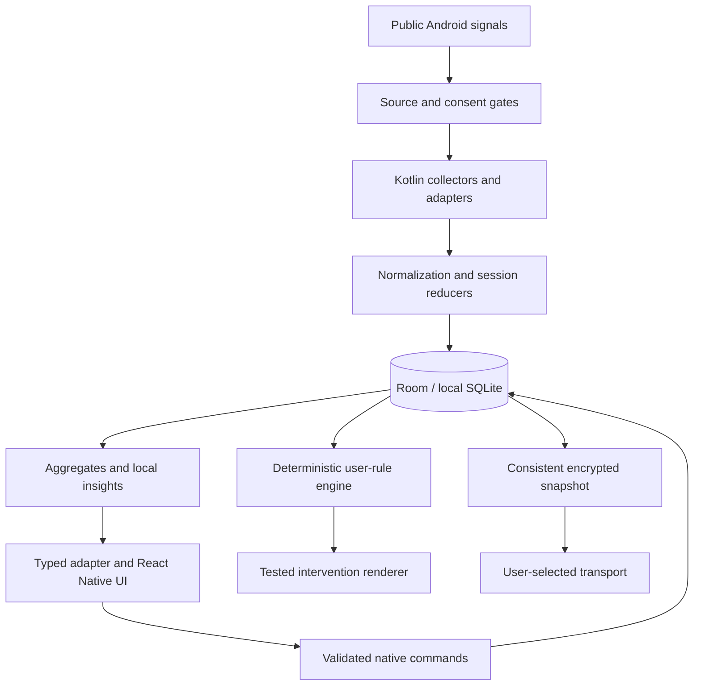

# Architecture

**Status:** Accepted mobile-client boundaries; implementation pending. Updated 2026-10-27.
**Responsibility:** Owns subsystem boundaries, runtime lifecycle, data flow and future adapters.
**Related specifications:** [Contracts](NATIVE-CONTRACTS.md), [Models](DATA-MODELS.md), [Structure](FILE-STRUCTURE.md), [Dependencies](DEPENDENCIES.md), [Security](SECURITY.md).
**Unresolved feasibility:** F-02–F-04, F-07 and F-08 in [Decisions](DECISIONS.md); service strategy, toolchain and encryption are not build-verified.

## Runtime boundaries

Supported product targets are mobile: Android first, future iOS through native adapters. React Native renders mobile components; do not introduce React Native Web, a website/PWA/desktop runtime, an embedded copy of the browser study, or browser-extension scaffolding. AS-033 is a completed non-shipping design reference. A potential Chrome extension is deferred beyond mobile completion and would require a separate design/task decision (ADR-024).

| Layer | Responsibility | Forbidden ownership |
|---|---|---|
| React Native Community CLI / TypeScript / New Architecture | Screens, input validation, accessible charts, read-model cache and navigation | Behavioral-history persistence, background collection timers, authoritative enforcement |
| Typed platform adapter | Capability discovery, requests, result/error mapping, change invalidation | Fabricating unsupported platform behavior |
| Kotlin collectors | Usage/event queries, narrow accessibility detectors, optional notification listener, consent gates and health | Storing full accessibility trees or bypassing user configuration |
| Native domain services | Session reduction, aggregates, deterministic rule evaluation, local insights and transactional mutation | Autonomous actions based on predictions |
| Room-backed local SQLite | One authoritative behavioral/configuration store, consent revisions, cursors, derived data and job state | A competing JS history store |
| Backup/crypto service | Consistent snapshots, authenticated encryption, staging, validated restore, transport abstraction | Publishing plaintext or importing directly into the live store |
| MMKV | Small non-sensitive interface preferences such as theme and chart layout | Rules, consent, history, recovery keys or provider tokens |

Room is a SQLite abstraction, not encryption by itself. At-rest encrypted database integration needs a maintained compatible driver and audit under AS-006. Device storage protections alone must not be advertised as app-level database encryption. See [Room documentation](https://developer.android.com/jetpack/androidx/releases/room).

## Data flow

Queries are bounded and off the UI thread. JS cache subscribes to revision invalidations and re-queries; change events carry IDs/revisions, never bulk sensitive history. Native transactions commit configuration, ingestion cursors and revision atomically. Public interfaces use epoch milliseconds and explicit units; platform objects and database handles never cross the bridge.

## Native lifecycle

Collection belongs to native components selected for each source. Accessibility and notification services are system-bound, not arbitrary always-on tasks. Usage queries need a tested combination of permitted scheduling and user-visible operation. WorkManager is for deferrable reconciliation/backup work, not continuous real-time detection. A foreground service is an option only if its purpose/type and start conditions qualify; do not mislabel it to keep a process alive.

On user enablement: verify grant → commit consent/config revision → start permitted components → establish coverage. On app UI startup: read native status, reconcile bounded history, then subscribe. On JS death: native collection and rules continue when Android permits. On native process death: persisted cursors/configuration allow idempotent reconciliation; uncertain intervals remain gaps. On force-stop: no promise of automatic restart; show the gap when the app next runs.

On reboot, use permitted boot handling to re-evaluate schedules and request allowed work after user unlock. Do not access credential-encrypted history before unlock; no sensitive direct-boot store is planned. Background launch and foreground-service restrictions vary by target/API and service type. See [Android start restrictions](https://developer.android.com/develop/background-work/services/fgs/restrictions-bg-start). OEM battery rules, restricted mode, listener disconnection and revocation require visible health states and recovery guidance. No permanent wake lock, hidden service or automatic battery exemption.

## Mutations and consistency

One serialized write coordinator owns consent/configuration changes, ingestion, deletion, migrations and restore barriers. Reads use consistent snapshots and cancellable jobs. Every configuration mutation includes expected revision and command ID. Rule engine consumes a revisioned snapshot; UI previews are advisory until native validation commits them. Source enablement, historical deletion and restore carry ingestion fences to prevent overlap replay from resurrecting removed records.

Deletions invalidate aggregates/models and backup freshness. Restore takes an exclusive mutation barrier only after the archive has been fully validated in staging; pause new writes safely, transactionally swap/rebind, reconcile generations, and explicitly resume user-selected sources. A failed validation never acquires a destructive path. Do not replace an open WAL database file casually.

## Platform and network boundaries

The platform adapter exposes supported, degraded, denied, disabled and unavailable separately. Shared UI/domain concepts do not assume Android permission names or event fidelity. iOS must implement its own native backing store and equivalent domain semantics, or return unsupported; it cannot use MMKV as a second behavioral store.

There is no application backend, product account or analytics pipeline. Default builds should have no application-initiated network traffic. Future approved backup transport, if any, sits behind explicit opt-in and provider credentials; system document providers may communicate independently. Model and category logic are bundled and local. [Privacy](PRIVACY.md) owns data movement and [Security](SECURITY.md) owns verification.
